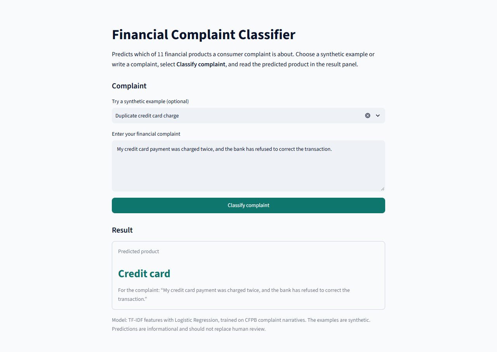

# Financial Complaint Classifier

An NLP-based machine learning project that automatically classifies consumer financial complaints into **11 financial product categories** using TF-IDF and Logistic Regression.

The project focuses on reproducible machine learning, data quality, evaluation integrity, automated testing, and reusable inference components.

It includes a Streamlit application for interactive predictions.

## 1. Project Overview

This project uses consumer complaint narratives from the Consumer Financial Protection Bureau (CFPB) Consumer Complaint Database.

The main objective is to build a machine learning pipeline that can classify financial complaints into their corresponding product categories.

Beyond model training, the project investigates evaluation reliability, near-duplicate contamination, class imbalance, and reproducibility.

Key engineering features include:

- End-to-end scikit-learn classification pipeline.
- Automated data cleaning and duplicate detection.
- TF-IDF text representation with Logistic Regression.
- Near-duplicate analysis using cosine similarity.
- Group-disjoint train/validation/test splitting.
- Frozen evaluation partitions using unique Complaint IDs.
- SHA-256 dataset and split-manifest fingerprint verification.
- Automated unit and integration tests.
- GitHub Actions continuous integration.
- Interactive Streamlit application.

## 2. Dataset

**Source attribution:** [CFPB Consumer Complaint Database](https://www.consumerfinance.gov/data-research/consumer-complaints/)

The local schema, notebooks, and recorded source citations strongly support CFPB Consumer Complaint Database-derived data. The original download URL, intermediary host, and export filters remain unverified; this citation does not establish a direct download from CFPB. See Section 18.2 for the public-record verification and publication disclosure.

| Property | Value |
|---|---|
| Rows in retained raw export | 614,945 |
| Cleaned records | 19,163 |
| Target column | `Product` |
| Input column | `Consumer complaint narrative` |
| Number of classes | 11 |
| Unique identifier | `Complaint ID` |

The original experiments used the dataset export:

`CCDB_Export_16_March_2026.csv`

Different CFPB exports, filters, or cleaning implementations may produce different datasets and results.

### 2.1 Data Cleaning

The cleaning pipeline:

1. Removes records with missing complaint narratives or invalid Product labels.
2. Removes narratives that become empty after normalization.
3. Removes narratives associated with conflicting product labels.
4. Removes exact duplicate narratives.
5. Removes groups with conflicting labels after normalization.
6. Removes normalized duplicate narratives.

Text normalization is used for duplicate detection only.

Normalization includes:

- Converting text to lowercase.
- Removing standalone `XXXX` placeholders.
- Normalizing whitespace.

The original complaint narratives are preserved for classification.

Product labels must be non-empty category strings. `None`, `NaN`, blank or whitespace-only strings, integers, and booleans are removed before conflict detection and deduplication. Valid labels are preserved without trimming. `train_model()` applies the same rule and rejects invalid labels before fitting. The verified existing cleaned dataset contains **0 invalid Product labels**; no frozen data was regenerated for this change.

**Important limitation:** Deduplication and conflicting-label filtering are performed during dataset construction before splitting. These operations affect the evaluation population and should not be interpreted as evidence that every possible source of data leakage has been eliminated.

Raw and processed datasets are excluded from version control.

## 3. Model Architecture

The classification pipeline uses TF-IDF feature extraction followed by multinomial-capable Logistic Regression.

```text
Consumer Complaint Narrative
           |
           v
    TF-IDF Vectorizer
           |
           v
    Logistic Regression
           |
           v
Predicted Product Category
```

Both components are combined using a scikit-learn `Pipeline`.

This ensures that the predictive TF-IDF vectorizer is fitted on training data rather than on the held-out test data.

### 3.1 Selected Hyperparameters

| Parameter | Value |
|---|---|
| TF-IDF `min_df` | 2 |
| TF-IDF `ngram_range` | (1, 2) |
| Logistic Regression `C` | 2.0 |
| Logistic Regression `max_iter` | 1000 |
| Logistic Regression `class_weight` | balanced |
| Group similarity threshold | 0.95 |
| Split seeds for new experiments | 42 (test split), 43 (validation split) |

The classifier configuration was selected during earlier validation experiments and stratified cross-validation.

The current evaluation milestone does not introduce new hyperparameter tuning based on held-out test results.

## 4. Evaluation Methodology

The project originally used a random stratified train/test split.

Near-duplicate diagnostic analysis subsequently identified highly similar complaint narratives across the original training and test partitions.

To improve evaluation rigor, the main evaluation workflow was updated to use a **group-disjoint splitting protocol**.

### 4.1 Original Stratified Evaluation

The original evaluation used:

- Training samples: 15,330
- Test samples: 3,833
- Stratified random split
- Random seed: 42

Results:

| Metric | Score |
|---|---:|
| Accuracy | 81.55% |
| Macro-F1 | 73.80% |

These results are preserved as a historical baseline.

Random stratification maintains approximately similar class proportions but does not guarantee separation of highly similar narratives.

### 4.2 Near-Duplicate Diagnostic Analysis

The original train/test split was analyzed using TF-IDF cosine similarity.

This historical diagnostic is retained as a recorded artifact. The current `python -m src.near_duplicate_analysis` entry point runs the frozen-split diagnostic described below; it does not reproduce the historical random-stratified experiment.

Recorded findings:

| Metric | Result |
|---|---:|
| Training samples | 15,330 |
| Test samples | 3,833 |
| Mean maximum similarity | 0.3515 |
| Median maximum similarity | 0.2700 |
| Test samples with similarity ≥ 0.80 | 421 |
| Test samples with similarity ≥ 0.90 | 340 |
| Test samples with similarity ≥ 0.95 | 263 |
| Test samples with similarity ≥ 0.99 | 85 |
| High-similarity accuracy (≥ 0.95) | 96.20% |
| Lower-similarity accuracy | 80.48% |

Of the 263 high-similarity test complaints, 231 belonged to the Debt collection category.

Within Debt collection, recall was:

- High-similarity group: 96.10%
- Lower-similarity group: 83.97%

These findings motivated the group-disjoint evaluation protocol.

However, high textual similarity alone does not establish direct target leakage. Differences in class distributions and complaint characteristics may partially explain the observed performance gap.

The historical diagnostic report is stored in:

`reports/near_duplicate_analysis.json`

The current diagnostic refuses this historical output filename, including case variants.

## 5. Group-Disjoint Evaluation

### 5.1 Motivation

Random splitting may place highly similar complaints in both training and testing partitions.

This can produce optimistic estimates of generalization to previously unseen complaint narratives.

The V1 frozen evaluation keeps detected groups within a single partition under the full-dataset grouping TF-IDF representation. This representation-dependent isolation does not establish that near-duplicate exposure is absent or reduced under the classifier's different TF-IDF representation.

### 5.2 Text Grouping

The grouping implementation is located in:

`src/grouping.py`

It follows these steps:

1. Convert complaint narratives into TF-IDF vectors using unigrams and bigrams.
2. Calculate pairwise cosine similarity using batched sparse computations.
3. Connect narratives whose similarity is at least 0.95.
4. Use connected components to identify groups of related narratives.
5. Assign each narrative a Group ID.

Connected components allow transitive grouping.

For example, if complaint A is highly similar to B, and B is highly similar to C, all three may belong to the same group even if A and C are not directly similar above the threshold.

The grouping process uses text from the full dataset before partition assignment.

It is therefore an unsupervised, transductive grouping procedure rather than a fully independent prospective evaluation design.

The predictive classifier's TF-IDF pipeline remains separate and is fitted on training data only.

### 5.3 Grouping Statistics

Recorded grouping statistics, including the independently verified total group count:

| Metric | Result |
|---|---:|
| Total complaints | 19,163 |
| Total text groups | 18,212 |
| Similarity threshold | 0.95 |

### 5.4 Train/Validation/Test Split

For new experiments, `split_data()` uses `GroupShuffleSplit` twice. The primary evaluation loads the existing frozen Complaint ID assignments and does not call `split_data()`.

First, it separates training/validation groups from held-out test groups.

Second, it divides the remaining groups into training and validation partitions.

The target proportions are approximately:

- Training: 64%
- Validation: 16%
- Testing: 20%

Because `GroupShuffleSplit` operates on groups rather than individual samples, the final sample proportions are not guaranteed to match these targets exactly.

**Actual frozen split:**

| Partition | Samples | Percentage |
|---|---:|---:|
| Train | 12,015 | 62.7% |
| Validation | 3,006 | 15.7% |
| Test | 4,142 | 21.6% |
| Total | 19,163 | 100% |

All 11 product categories were observed in the three partitions.

### 5.5 Group Isolation Verification

Group overlap was checked on the current frozen manifest and matching cleaned dataset using the project's grouping algorithm. This check verifies the current assignments under that grouping definition; it does not independently authenticate the historical origin of those assignments.

To reproduce this verification from the project root:

```powershell
python -B -m scripts.verify_group_isolation --data data/processed/cleaned_complaints.csv --manifest data/splits/group_split_manifest.csv
```

The command requires the matching local cleaned dataset, canonical manifest, and adjacent `data/splits/group_split_manifest.json` metadata. It verifies the current frozen assignments using the V1 grouping representation. Passing verification does not authenticate historical split membership or establish isolation under the classifier's different TF-IDF representation.

| Comparison | Shared Groups |
|---|---:|
| Train vs. Validation | 0 |
| Train vs. Test | 0 |
| Validation vs. Test | 0 |

No detected near-duplicate group crosses the partition boundaries under the full-dataset grouping representation (`min_df=1`) at threshold 0.95. This verifies isolation under that representation, not an absence of high-similarity train/test pairs under the classifier representation (`min_df=2`).

This does not guarantee that all semantic duplicates, related customers, or repeated real-world complaint events have been identified.

### 5.6 Group-Disjoint Evaluation Results

The selected TF-IDF and Logistic Regression classifier was evaluated using the group-disjoint held-out test partition.

| Metric | Current frozen group-disjoint holdout |
|---|---:|
| Accuracy | **0.8216** |
| Macro-F1 | **0.7214** |
| Test samples | **4,142** |

The reported group-disjoint evaluation used 15,021 training/validation complaints and 4,142 held-out test complaints.

The primary evaluation was rerun successfully locally after the controlled metadata migration. `reports/test_metrics.json` records accuracy `0.8215837759536456` and macro-F1 `0.7214272265340761`. These recorded results were inspected, not regenerated, during the documentation milestone.

The historical random-stratified and current frozen holdouts are not directly comparable: their test populations and class distributions differ. Their metric differences do not establish a causal effect of the splitting method or demonstrate reduced near-duplicate exposure under the classifier representation.

### 5.7 Frozen-Split Near-Duplicate Diagnostic

The separate report [near_duplicate_frozen_split.json](reports/near_duplicate_frozen_split.json) uses the same frozen partitions for classifier fitting, similarity scoring, and evaluation. The classifier and its TF-IDF vectorizer are fitted on **15,021 train-plus-validation complaints**, excluding all **4,142 test complaints**.

The V1 diagnostic identifies **residual high-similarity exposure** under the classifier representation: **426 of 4,142 test complaints (10.3%)** have maximum cosine similarity >= 0.95 to train-plus-validation complaints. The remaining **3,716** complaints fall below that threshold. Their respective subset accuracies are approximately **99.53%** and **80.17%**:

| Subset at diagnostic cosine threshold 0.95 | Samples | Accuracy |
|---|---:|---:|
| High similarity (>= 0.95) | 426 | 0.9953051643192489 |
| Lower similarity (< 0.95) | 3,716 | 0.8016684607104413 |

**423 of the 426 high-similarity complaints are Debt collection** (about 99.3%). The high accuracy describes this heavily imbalanced subset; it is not evidence of superior generalization across the 11 categories. The performance gap cannot be attributed solely to near-duplicate exposure because the subsets differ in class composition and may differ in difficulty; this diagnostic does not isolate those effects. Subset macro-F1 is computed over the labels present in its true or predicted values, so it should not be treated as the primary 11-class macro-F1.

For `debt_collection_performance`, every true label is Debt collection, so subset accuracy equals Debt collection recall: correctly classified Debt collection examples divided by all true Debt collection examples in that subset. Newly generated reports add an explicit `recall` field alongside the existing `samples` and `accuracy` fields. They retain `macro_f1` for backward compatibility and add `macro_f1_note` marking it as deprecated and not comparable to overall 11-class macro-F1. That legacy average includes other classes appearing only in predictions; it is not a meaningful measure of overall multiclass performance. Empty Debt collection subsets report zero samples and `null` metric values. The recorded frozen diagnostic JSON remains unchanged in its earlier schema.

The **80.17% lower-similarity accuracy is a subset diagnostic**, not an unbiased estimate of overall generalization and not a replacement for the **82.16% overall V1 frozen holdout accuracy** or **72.14% overall macro-F1**. Selecting test examples by their measured similarity changes the evaluated population.

The report explicitly records `similarity_vectorizer: "model_fitted_tfidf"`, `similarity_reference: "train_plus_validation"`, and `similarity_fit_excludes_test: true`. This representation uses `min_df=2` and differs from grouping's full-dataset TF-IDF representation (`min_df=1`, the default). Both use unigrams and bigrams. Consequently, 426 high-similarity diagnostic examples do not contradict zero cross-partition groups under the grouping representation: their cosine scores come from different fitted feature spaces.

Future diagnostic outputs use `evaluation_type: "frozen_holdout"`: the diagnostic verifies and loads frozen assignments but does not independently recompute group isolation. V1 group isolation was checked separately. The recorded diagnostic retains its original `frozen_group_disjoint_holdout` label and is not regenerated for this provenance correction.

The historical random-stratified diagnostic remains [near_duplicate_analysis.json](reports/near_duplicate_analysis.json), with 3,833 test samples and 263 high-similarity samples. It must not be relabeled as a frozen-split result.

The four report files have distinct roles:

| Report | Role |
|---|---|
| `reports/test_metrics.json` | Current primary frozen holdout metrics |
| `reports/near_duplicate_frozen_split.json` | Current frozen holdout similarity diagnostic |
| `reports/near_duplicate_analysis.json` | Historical random-stratified similarity diagnostic |
| `reports/group_aware_evaluation.json` | Earlier separate group-aware diagnostic, which creates its own split |

The historical random-stratified aggregate accuracy (0.8155) and macro-F1 (0.7380) are retained as historical experiment results above; there is no separate archived random-split primary-metrics JSON in the current report directory.

## 6. Per-Class Performance

The group-disjoint evaluation produced the following results:

| Product Category | Precision | Recall | F1 | Support |
|---|---:|---:|---:|---:|
| Checking or savings account | 0.756 | 0.788 | 0.772 | 660 |
| Credit card | 0.827 | 0.794 | 0.810 | 680 |
| Credit reporting or other personal consumer reports | 0.509 | 0.785 | 0.618 | 107 |
| Debt collection | 0.926 | 0.904 | 0.914 | 1,513 |
| Debt or credit management | 0.647 | 0.289 | 0.400 | 38 |
| Money transfer, virtual currency, or money service | 0.709 | 0.703 | 0.706 | 350 |
| Mortgage | 0.930 | 0.920 | 0.925 | 275 |
| Payday loan, title loan, personal loan, or advance loan | 0.484 | 0.616 | 0.542 | 125 |
| Prepaid card | 0.667 | 0.500 | 0.571 | 40 |
| Student loan | 0.921 | 0.848 | 0.883 | 138 |
| Vehicle loan or lease | 0.812 | 0.778 | 0.794 | 216 |

Aggregate metrics:

| Metric | Score |
|---|---:|
| Accuracy | 0.8216 |
| Macro precision | 0.744 |
| Macro recall | 0.720 |
| Macro-F1 | 0.7214 |
| Weighted-F1 | 0.823 |

### 6.1 Minority-Class Error Analysis

Debt or credit management was the weakest category by F1-score.

Out of 38 test examples:

- Correct predictions: 11
- Incorrect predictions: 27
- Recall: 0.289
- F1-score: 0.400

Its 27 misclassified examples were predicted as:

| Predicted Category | Count |
|---|---:|
| Debt collection | 12 |
| Credit reporting or other personal consumer reports | 6 |
| Credit card | 4 |
| Checking or savings account | 3 |
| Payday loan, title loan, personal loan, or advance loan | 1 |
| Vehicle loan or lease | 1 |

The largest confusion was with Debt collection.

Potential explanations include overlapping financial terminology, limited training examples, and differences in complaint narratives.

These are hypotheses rather than established causes.

The model configuration was intentionally kept unchanged during this evaluation milestone to avoid selecting improvements based on held-out test performance.

## 7. Frozen Evaluation Split

### 7.1 Motivation

A fixed random seed alone does not guarantee identical record membership if dataset row order or group numbering changes.

To preserve the evaluation partitions, the project uses a frozen split manifest.

The manifest is stored at:

`data/splits/group_split_manifest.csv`

It maps each Complaint ID to one of three partitions:

- `train`
- `validation`
- `test`

The cleaned dataset contains 19,163 unique, non-null Complaint IDs.

### 7.2 Split Manifest

Example structure:

```csv
Complaint ID,split
1001,train
1002,validation
1003,test
```

The IDs above are illustrative.

The actual manifest contains one assignment for each of the 19,163 cleaned complaints.

### 7.3 Frozen Split Loader

The implementation is located in:

`src/train.py`

Function:

`load_frozen_split()`

It:

1. Loads the cleaned dataset and saved manifest.
2. Validates Complaint ID uniqueness.
3. Rejects missing Complaint IDs.
4. Validates the allowed split names.
5. Checks that dataset and manifest identifiers match.
6. Verifies both the dataset and manifest fingerprints against saved metadata, rejecting missing or mismatched digests.
7. Joins records with split assignments by Complaint ID.
8. Returns the frozen training, validation, and test partitions.

The loader does not regenerate similarity groups or choose new partitions.

### 7.4 Order Independence

The manifest uses Complaint ID instead of DataFrame row position as the persistent identifier.

Automated tests verified that the frozen loader preserves partition membership after shuffling the input dataset.

The training and validation partitions are combined when fitting the final selected model.

The test partition is excluded from model fitting.

## 8. Dataset and Manifest Fingerprint Verification

To detect unintended changes to the dataset, the project uses SHA-256 fingerprint verification.

Implementation:

`src/data_integrity.py`

Functions:

- `compute_dataset_fingerprint()`
- `verify_dataset_fingerprint()`
- `compute_manifest_fingerprint()`

The fingerprint is calculated from:

- `Complaint ID`
- `Consumer complaint narrative`
- `Product`

Records are sorted by Complaint ID before serialization and hashing.

Therefore, changing dataset row order does not change the fingerprint.

Changes to the selected identifiers, complaint narratives, or labels are detected by the fingerprint.

### 8.1 Metadata File

The fingerprint and related metadata are stored in:

`data/splits/group_split_manifest.json`

The metadata includes:

- Dataset fingerprint.
- Manifest fingerprint.
- Fingerprint algorithm.
- Fingerprint columns.
- Total number of records.
- Split counts.

### 8.2 Integrity Checks

Before frozen splits are returned, the loader compares both current fingerprints with the saved values. The dataset digest covers IDs, narratives, and targets. The manifest digest separately covers the Complaint ID-to-split assignments, detecting count-preserving swaps as well as other assignment changes.

A mismatch raises an error rather than silently continuing with a different dataset.

Tests verify that:

- Identical data passes verification.
- Reordered data produces the same fingerprint.
- Modified complaint text changes the fingerprint.
- Modified data is rejected by verification.
- Missing or inconsistent identifiers are rejected.

**Limitation:** The fingerprint records the dataset state when the metadata was created. It cannot retrospectively prove that the dataset had not changed before that point.

It also does not cover metadata columns outside the three fingerprinted fields.

### 8.3 Verified Frozen Artifact Digests

| Artifact | SHA-256 content fingerprint |
|---|---|
| Cleaned dataset | `09b2851fb0db6116bec1360ecc70e52f56598fe4ae3f872799448113b932f8a7` |
| Complaint ID-to-split manifest | `275c792272dcdb373834042224ff840de8bc4c5a616d1f4bca0439eeb74dbb47` |

These are canonical content fingerprints, not raw CSV file checksums. Dataset records are sorted by Complaint ID and encoded using the legacy JSON serialization. Manifest records contain only `Complaint ID` and `split`, sorted by Complaint ID and serialized as UTF-8 JSON with sorted keys, compact separators, unescaped Unicode, and NaN forbidden. Both hashes are independent of row order; value types remain significant.

The legacy CSV parser infers integer Complaint IDs, which are serialized as JSON numbers. The migration utility rejects ambiguous forms such as leading zeros, whitespace, or decimal notation instead of silently coercing them. The dataset hash serialization has not been changed.

## 9. Project Structure

```text
financial-complaint-classifier/
|
|-- app.py
|
|-- assets/
|   `-- streamlit-demo.png
|
|-- data/
|   |-- raw/                     # Local source dataset
|   |-- processed/               # Local cleaned dataset
|   `-- splits/
|       |-- group_split_manifest.csv
|       `-- group_split_manifest.json
|
|-- models/                       # Local model artifacts
|
|-- notebooks/
|   |-- 01_data_understanding.ipynb
|   |-- 02_text_preprocessing.ipynb
|   |-- 03_baseline_model.ipynb
|   `-- 04_model_experiments.ipynb
|
|-- src/
|   |-- data_processing.py
|   |-- train.py
|   |-- predict.py
|   |-- evaluate.py
|   |-- grouping.py
|   |-- data_integrity.py
|   |-- near_duplicate_analysis.py
|   `-- group_aware_evaluation.py
|
|-- scripts/
|   |-- create_split_manifest.py
|   |-- create_split_metadata.py
|   |-- migrate_split_metadata.py
|   `-- verify_group_isolation.py
|
|-- tests/
|   |-- test_data_processing.py
|   |-- test_train.py
|   |-- test_predict.py
|   |-- test_evaluate.py
|   |-- test_near_duplicate_analysis.py
|   |-- test_group_aware_evaluation.py
|   |-- test_migrate_split_metadata.py
|   |-- test_verify_group_isolation.py
|   `-- test_app.py
|
|-- reports/
|   |-- test_metrics.json
|   |-- near_duplicate_analysis.json
|   |-- near_duplicate_frozen_split.json
|   `-- group_aware_evaluation.json
|
|-- .github/
|   `-- workflows/
|       `-- tests.yml
|
|-- .gitignore
|-- requirements.txt
|-- requirements-dev.txt
`-- README.md
```

Raw and processed datasets, trained model artifacts, and local environments are excluded from version control.

The canonical split manifest CSV and matching metadata JSON are V1 publication artifacts, as described in Section 18.2. Raw and processed complaint datasets remain excluded from version control.

This tree describes the working project, not a guarantee that every file is committed. Local `group_split_manifest.candidate.json` and `group_split_manifest.legacy-backup.json` are migration audit artifacts, not alternative runtime inputs. They are deliberately omitted from the main tree; the loader reads the canonical `.csv` and its matching `.json` only.

## 10. Installation

Python 3.14 was used in the reported local development and test environment.

### 10.1 Clone the Repository

```powershell
git clone https://github.com/hazem-elsayed1/financial-complaint-classifier.git
cd financial-complaint-classifier
```

### 10.2 Create a Virtual Environment

```powershell
python -m venv .venv
```

### 10.3 Activate the Environment

Windows PowerShell:

```powershell
.\.venv\Scripts\Activate.ps1
```

macOS / Linux:

```bash
source .venv/bin/activate
```

### 10.4 Install Dependencies

Runtime dependencies:

```powershell
python -m pip install -r requirements.txt
```

Development and testing dependencies:

```powershell
python -m pip install -r requirements-dev.txt
```

The development requirements include the runtime dependencies.

SciPy is explicitly pinned as a runtime dependency (`scipy==1.18.1`), because grouping directly imports sparse matrices and graph connected components. It is not left solely to scikit-learn's transitive dependencies. The other pinned runtime packages are pandas, NumPy, scikit-learn, joblib, and Streamlit.

## 11. Dataset Preparation

For a new experiment, public CFPB complaint data is available at:

https://www.consumerfinance.gov/data-research/consumer-complaints/

The retained local export used for V1 is named:

`CCDB_Export_16_March_2026.csv`

Place the export in:

`data/raw/`

For a new experiment, run the cleaning pipeline to a separate destination:

```powershell
python -m src.data_processing --input data/raw/CCDB_Export_16_March_2026.csv --output data/processed/new_experiment_complaints.csv
```

The original export contains 614,945 records and produced 19,163 cleaned complaints during the recorded experiments.

Different dataset versions or cleaning changes may produce different outputs.

The CLI overwrites its selected output. Do not point it at the existing frozen `cleaned_complaints.csv` to reproduce the recorded evaluation. Use the matching retained dataset and verify its content fingerprint instead.

## 12. Reproducing the Frozen Evaluation

The current evaluation workflow requires:

1. The matching cleaned CFPB dataset.
2. The frozen split manifest CSV.
3. Its corresponding fingerprint metadata JSON.
4. The selected model configuration.

Expected paths:

```text
data/processed/cleaned_complaints.csv
data/splits/group_split_manifest.csv
data/splits/group_split_manifest.json
```

### 12.1 Creating a Manifest for a New Experiment

The project includes a manifest-generation utility:

```powershell
python -m scripts.create_split_manifest
```

This command creates a new group-disjoint partition assignment and corresponding fingerprint metadata.

**Do not run this command to replace an existing frozen evaluation.**

The script rejects creation if its output manifest or metadata already exists.

Generating a new manifest establishes a new evaluation split. It is not automatically equivalent to reproducing the historical frozen split.

To reproduce the original reported test membership, the original manifest must be retained and used with the matching dataset.

### 12.2 Creating Metadata for an Existing Manifest

For an existing manifest without fingerprint metadata, the project provides:

```powershell
python -m scripts.create_split_metadata
```

This command generates fingerprint metadata without regenerating the split.

It rejects attempts to overwrite existing metadata.

The current fingerprint metadata reflects the dataset state when it was created, and does not provide retrospective integrity guarantees.

### 12.3 Controlled Migration of Legacy Metadata

The existing metadata was migrated, and the primary evaluation was then rerun locally. Metadata creation and migration are separate operations: `create_split_metadata` requires absent metadata; `migrate_split_metadata` validates existing metadata and proposes an addition without replacing it.

Read-only validation and proposal, from the project root:

```powershell
python -m scripts.migrate_split_metadata --data data/processed/cleaned_complaints.csv --manifest data/splits/group_split_manifest.csv --metadata data/splits/group_split_manifest.json
```

With no `--output`, the proposed JSON is printed to standard output only. To create a review candidate, append `--output data/splits/group_split_manifest.review-candidate.json`; the destination must not already exist. No source file is overwritten. Matching existing manifest fingerprints are retained; conflicting fingerprints are rejected.

The utility checks the legacy dataset digest, integer ID representation, exact dataset/manifest ID sets, valid split assignments, saved split counts, and the required saved total count. Missing `total_samples`, non-integer counts (including booleans), or a total that differs from the manifest are rejected before a proposal is printed or a candidate is written. No missing count is inferred. It preserves every existing metadata field and adds only the manifest digest. A separately trusted historical manifest can be supplied with `--trusted-manifest path/to/trusted_manifest.csv` for exact canonical mapping comparison.

No independently trusted historical manifest was available for the recorded verification and migration. The current dataset, manifest IDs, split counts, fingerprints, and near-duplicate group isolation were validated, but the original ID-to-split membership was **not independently authenticated**. Matching the dataset digest and split counts does not prove the manifest never changed; the saved manifest fingerprint protects the reviewed current mapping against subsequent changes relative to that digest. A candidate or legacy metadata backup is not an independent historical manifest.

Without a trusted historical manifest, the utility emits an explicit provenance warning. Promotion of a candidate to canonical metadata requires separate review and an explicit operator action; the utility never performs that replacement. Retain a legacy backup for the audit trail, away from the public release unless deliberately reviewed.

### 12.4 Verify Frozen Split Loading

From the project root:

```python
from src.train import load_frozen_split

X_train, X_val, X_test, y_train, y_val, y_test = (
    load_frozen_split(
        "data/processed/cleaned_complaints.csv"
    )
)

print(len(X_train), len(X_val), len(X_test))
```

The recorded local smoke test returned:

```text
12015 3006 4142
```

All 19,163 records were represented.

### 12.5 Run the Final Evaluation

Once the matching dataset, manifest, and metadata are available:

```powershell
python -c "from src.evaluate import run_evaluation; run_evaluation('data/processed/cleaned_complaints.csv', 'reports/test_metrics_reproduction.json')"
```

The evaluation script:

1. Loads the frozen partitions.
2. Verifies dataset and manifest integrity.
3. Trains the selected pipeline on Train + Validation.
4. Predicts labels for the held-out Test partition.
5. Computes aggregate and per-class metrics.
6. Saves the results to the selected report path.

The report includes:

- Accuracy.
- Macro-F1.
- Per-class precision, recall, F1-score, and support.
- Classification report.
- Confusion matrix.
- Class labels and evaluation metadata.

`python -m src.evaluate` is also supported, but its default output is `reports/test_metrics.json`. Both forms overwrite their selected output; use a fresh reproduction filename to preserve recorded results.

The full frozen evaluation was successfully rerun locally after metadata migration. This documentation milestone inspected its saved report and did not retrain or regenerate metrics.

### 12.6 Frozen-Split Similarity Diagnostic

The current entry point is:

```powershell
python -m src.near_duplicate_analysis
```

Its default output is `reports/near_duplicate_frozen_split.json`, which it overwrites. To preserve the recorded diagnostic, select a new output explicitly:

```powershell
python -c "from src.near_duplicate_analysis import analyze_near_duplicates; analyze_near_duplicates('data/processed/cleaned_complaints.csv', 'reports/near_duplicate_frozen_reproduction.json', 'data/splits/group_split_manifest.csv')"
```

Both use the frozen loader and train on train plus validation. Neither regenerates split assignments. Empty fitting or test partitions are rejected. The historical `near_duplicate_analysis.json` filename is protected.

### 12.7 Historical Group-Aware Diagnostic

The separate diagnostic function remains available:

```python
from src.group_aware_evaluation import evaluate_group_aware

report = evaluate_group_aware(
    report_path="reports/group_aware_new_experiment.json"
)
print(report)
```

It constructs groups and performs its own group-disjoint train/test evaluation.

This is different from the primary frozen three-partition workflow.

Calling `evaluate_group_aware()` uses a newly constructed split; it is not the reproduction path for the frozen holdout. Existing output paths are rejected with `FileExistsError` before data loading, grouping, or model fitting. The historical default path remains `reports/group_aware_evaluation.json`, so a default call rejects that existing report instead of replacing it. Choose a new report path for a new experiment. Replacing a selected report requires the explicit keyword argument `overwrite=True`; do not use it on preserved historical artifacts.

New reports include `split_source: "newly_generated_group_shuffle_split"` to distinguish them from the retained historical report and the primary frozen evaluation. No historical report was regenerated for this change. Running `python -m src.group_aware_evaluation` executes a small grouping demonstration rather than the full diagnostic evaluation.

## 13. Training the Model

After preparing the cleaned dataset and matching frozen split files:

```python
from src.train import train_final_model, save_model

model = train_final_model(
    "data/processed/cleaned_complaints.csv"
)

save_model(
    model,
    "models/ticket_classifier.joblib"
)
```

The final selected model is trained on the combined Train and Validation partitions, consisting of 15,021 complaints.

The held-out Test partition contains 4,142 complaints and is excluded from model fitting.

The model artifact is saved locally and is excluded from Git.

Only trusted model artifacts should be loaded because pickle-based serialization formats, including joblib, can execute arbitrary code during deserialization.

## 14. Making Predictions

```python
from src.predict import load_model, predict_complaint

model = load_model(
    "models/ticket_classifier.joblib"
)

prediction = predict_complaint(
    model,
    "My credit card payment was charged twice."
)

print(prediction)
```

Predictions represent model-generated financial product classifications and should not be treated as verified financial or legal conclusions.

## 15. Interactive Streamlit Demo



The project includes a Streamlit interface for testing the trained classifier.

### Features

- Enter a financial complaint in a text area.
- Classify the complaint using the trained model.
- Display the predicted financial product category.
- Validate empty inputs.
- Cache the loaded model to avoid repeated loading.

### Running the Application

Install runtime dependencies:

```powershell
python -m pip install -r requirements.txt
```

Prepare the required dataset and frozen split files, then train and save the model as described above.

Launch Streamlit:

```powershell
python -m streamlit run app.py
```

Open:

`http://localhost:8501`

### Example Complaint

> My credit card payment was charged twice, and the bank has refused to correct the transaction.

The recorded local demonstration predicted:

**Credit card**

The application is intended for demonstration and informational use. It should not replace human review in high-impact financial decisions.

## 16. Automated Testing

The project uses pytest for automated testing.

Run all tests:

```powershell
python -m pytest -v
```

Or use:

```powershell
python -m pytest tests/ -q
```

The latest verified local complete regression run passed **235 tests** using `python -m pytest tests/ -q`. This is a local result, not a claim about a GitHub Actions run or deployed service.

The tests cover:

- Data cleaning and deduplication.
- Missing and empty complaint narratives.
- Conflicting product labels.
- Data-processing CLI behavior.
- TF-IDF text grouping.
- Connected components.
- Grouping consistency across batches.
- Group-disjoint splitting.
- Duplicate isolation.
- Training/validation/test separation.
- Split reproducibility.
- Frozen manifest order independence.
- Missing Complaint ID rejection.
- Dataset fingerprint computation.
- Fingerprint mismatch rejection.
- Model serialization and deserialization.
- Evaluation report generation.
- Prediction validation.
- Streamlit application behavior.
- Manifest overwrite protection.
- Manifest fingerprinting, count-preserving assignment swaps, and missing digests.
- Controlled metadata migration, provenance warnings, field preservation, and candidate overwrite refusal.
- Frozen diagnostic membership, vectorizer metadata, subset metrics, and historical report protection.
- Missing, blank, integer, and boolean Product labels; rejection before model fitting.

Automated tests supplement, but do not replace, validation on real data or production deployment testing.

## 17. Continuous Integration

The repository uses GitHub Actions to run automated tests.

Workflow:

`.github/workflows/tests.yml`

The documented workflow runs on pushes and pull requests using Ubuntu and Python 3.14.

It installs development dependencies and executes:

```powershell
python -m pytest tests/ -q
```

This helps detect regressions during development.

The default suite uses synthetic data and temporary dataset, manifest, metadata, and model files. It does not require local CFPB exports or frozen artifacts. A report-consistency test reads the tracked historical aggregate JSON. The workflow configuration was inspected; no remote GitHub Actions outcome is asserted here.

## 18. Reproducibility

The project includes several reproducibility controls:

- Fixed splitting seed.
- Group-disjoint train/validation/test partitions.
- Frozen Complaint ID-to-split assignments.
- Order-independent split loading.
- SHA-256 dataset and manifest fingerprint verification.
- A single scikit-learn model pipeline.
- Saved evaluation reports.
- Automated tests.
- Pinned direct dependencies.

Reproducing the reported evaluation requires the matching dataset snapshot and frozen split files.

A matching random seed alone does not guarantee preservation of the same test membership if dataset ordering or group construction changes.

The split manifest and metadata should be preserved as experiment artifacts.

### 18.1 Evaluation Report Provenance

The primary evaluation report, `reports/test_metrics.json`, records the frozen holdout evaluation and its associated provenance.

The report includes:

- `split_source: "frozen_complaint_id_manifest"` to identify the source of evaluation partitions.
- `dataset_fingerprint` and `manifest_fingerprint` obtained from the verified frozen artifacts.
- `total_samples` and `split_counts` to document the evaluation population.
- `model_fit_samples` to record the combined training and validation sample count.
- `historical_membership_authentication: "not_independently_authenticated"` to disclose the limitation of the available historical evidence.

The evaluation loads existing Complaint ID assignments rather than running `GroupShuffleSplit` again. The recorded fingerprints verify consistency with the reviewed dataset and manifest snapshots; they do not independently establish the original historical split membership.

The latest verified frozen evaluation used 15,021 training-plus-validation samples and 4,142 held-out test samples, achieving 0.8216 accuracy and 0.7214 macro-F1.

These results use a different holdout population from the historical random-stratified evaluation and should not be interpreted as a direct performance improvement over that experiment.

### 18.2 Data Source and Publication

V1 publication includes the reviewed canonical `data/splits/group_split_manifest.csv` and `data/splits/group_split_manifest.json`. The manifest contains only `Complaint ID` and `split`; the metadata contains fingerprints, schema information, and aggregate counts. Dataset counts, the retained export filename, source attribution, and the unverified acquisition details are described in Section 2.

On November 16, 2026 (Cairo time), a deterministic sample of 12 Complaint IDs, four per partition, was checked against CFPB's official public API. All 12 returned HTTP 200 with an exact Complaint ID match; none were unmatched or unverifiable. Within each partition, selection used ascending SHA-256 of ASCII `CFPB-public-source-check-v1:` followed by the canonical decimal Complaint ID, with numeric ID tie-breaking, taking the first four. The other 19,151 IDs were not individually checked. This verifies public availability for the sample only, not for every manifest ID or the original download route.

Complaint IDs are linkable to public complaint records and are **not anonymous**. CFPB documents Complaint ID as a published field and explains that directly identifying personal information is excluded from its public database. Publishing this manifest still enables record linkage. See [How CFPB shares complaint data](https://www.consumerfinance.gov/complaint/data-use/).

CFPB makes its [published complaint data available for use, analysis, and building upon](https://www.consumerfinance.gov/data-research/consumer-complaints/). Its [website privacy policy and legal notices](https://www.consumerfinance.gov/privacy/website-privacy-policy/) permit reproduction and publication of CFPB-created information, encourage source attribution, and retain caveats for third-party rights and trademarks. This disclosure does not assert blanket licensing of consumer-authored narratives.

The manifest fingerprint verifies consistency with the reviewed current assignments, not independent historical membership authenticity. No independently trusted historical manifest was available; see Section 12.3 for the provenance limitation.

Raw and processed datasets, trained model artifacts, temporary migration candidates, and local legacy metadata backups remain excluded from version control. The canonical CSV and JSON are the publication artifacts; candidates and backups are local audit copies, not alternative runtime inputs. Review notebook outputs and demonstration assets for retained complaint content before publication; they were not exhaustively privacy-audited here. Do not bulk-stage `data/`.

## 19. Known Limitations

### 19.1 Evaluation Limitations

- Group construction fits unsupervised TF-IDF with `min_df=1` across all narratives, while classifier TF-IDF uses `min_df=2` fitted on train plus validation. V1 group isolation is representation-dependent and leaves 426 high-similarity test examples under the classifier representation.
- Full-dataset grouping is transductive; its isolation checks and the lower-similarity subset diagnostic do not establish unbiased overall or fully prospective generalization.
- TF-IDF cosine similarity may miss semantically similar narratives expressed using different wording.
- Connected components can produce large groups through transitive similarity links.
- GroupShuffleSplit does not guarantee class stratification.
- The current primary evaluation uses one frozen group-disjoint holdout.
- Identified text groups do not necessarily correspond to independent customers or real-world complaint events.
- The 0.95 similarity threshold is a methodological choice, not an independently validated universal threshold.
- Pre-split dataset cleaning and deduplication affect the evaluated population.
- No temporal or external validation has established performance on future complaints.

### 19.2 Model Limitations

- The classifier uses lexical TF-IDF features and may miss semantic context.
- Performance differs substantially across product categories.
- Minority categories have weaker recall.
- Debt or credit management achieved 0.289 recall on 38 held-out examples.
- Classification labels may overlap in terminology and complaint characteristics.
- Probability calibration and uncertainty estimates have not been established.

### 19.3 Engineering Limitations

- Pairwise text similarity grouping has approximately quadratic computational scaling.
- The frozen split depends on external dataset and manifest artifacts.
- Dataset integrity verification covers the ID, input text, and target label fields; a separate digest covers manifest assignments. Other dataset columns and model artifacts are outside those hashes.
- Split manifest and metadata generation are not implemented as a fully atomic transaction.
- The Streamlit application is a demonstration interface rather than a production inference service.
- Model artifact provenance, integrity verification, monitoring, and deployment hardening remain future work.

The current model is a tested ML prototype and should not be described as production-ready.

## 20. Future Improvements

Planned engineering improvements include:

- Expose the trained classifier through a FastAPI inference service.
- Package the inference service with Docker.
- Add API input validation and structured error handling.
- Add integration tests for the inference API.
- Add model artifact metadata and integrity verification.
- Measure inference latency and throughput.
- Deploy the inference service to a publicly accessible endpoint.
- Add basic operational logging and monitoring.

Potential future modeling experiments include:

- A V2 experiment investigating an aligned grouping representation, with a separately versioned manifest and evaluation reports. Preserve the existing V1 dataset snapshot, frozen split assignments, metadata, and evaluation reports. No V2 evaluation has been performed or reported here.
- Improving minority-class recall.
- Evaluating class confusion more deeply.
- Comparing additional text-classification approaches.
- Running temporal evaluation when suitable data is available.
- Performing repeated group-disjoint evaluation.
- Adding metric confidence intervals.
- Evaluating probability calibration.

Any future model selection should use appropriate training and validation data without repeatedly optimizing against the frozen test set.

## 21. License

No license file is present in the local working tree or tracked local history inspected for this release. Both this README and the locally cached `origin/main` README state that no license has been selected. No live remote history was fetched or checked; no discrepancy was found in the local references. A license decision remains a release task.
